# Monthloom technical architecture

## 1. Purpose and scope

Monthloom is a collaborative household finance application. Authenticated users organize income
and expenses by household, month, member, and source; invite other users into a household; and
manage recurring transactions. The same system also provides identity lifecycle, profiles,
owned-file management, feedback delivery, localization, PWA support, operational telemetry, and a
role-gated administration console.

This document describes the implemented system: its runtime architecture, application modules,
data model, important request flows, security controls, and operational characteristics. The
accepted design decisions behind it are recorded separately in [`docs/adr`](./adr/).

## 2. Functional overview

### Identity and profiles

- Register with email, password, and display name, then receive a server-side session.
- Log in, inspect the current identity, log out, and revoke the active session.
- Edit the display name, profile image, and preferred identifying color.
- Protect application pages on the Next.js server before rendering them.

### Household finance

- Create multiple households and select one primary household per user.
- Edit a household's name, icon, and color.
- Invite another registered user with a single-use, expiring link.
- List and remove members, leave a household, transfer ownership when its owner leaves, and delete
  a household as its owner.
- Record income and expenses for any member of the household. Entries include a date, amount,
  source, icon, color, recurrence settings, and an expense category where applicable.
- View monthly income, expenses, and leftover totals.
- Browse months and sort or filter transactions by kind/category, member, source, recurrence,
  date, or amount.
- Edit or remove one occurrence or a selected portion of a recurring series.
- Project recurring transactions into future months.
- Create and maintain household-specific sources, including normalized keys and aliases; copy
  selected sources between households.

### Supporting features

- Upload, list, download, and delete user-owned JPEG, PNG, and WebP files.
- Select one of ten visual themes and light or dark mode. Appearance is stored locally per browser
  rather than in the user profile.
- Render English, German, French, Albanian, and Turkish UI from repository-owned message catalogs.
- Install the web application as a PWA and show a static fallback while offline.
- Send feedback and account/household lifecycle email through an instrumented email adapter.
- Give administrators adoption, usage, retention, reliability, security, deployment, and
  account-suspension views without exposing raw personal finance data.
- Expose liveness/readiness probes, an OpenAPI document, and development-only Swagger UI.

## 3. System context

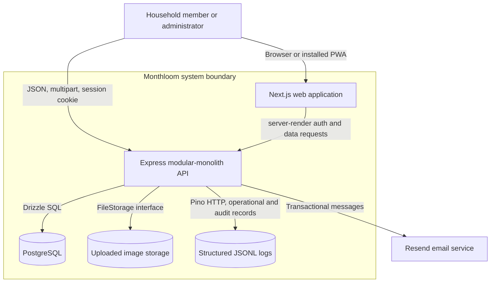

There are two independently deployable application processes:

- `apps/web`: Next.js 14 App Router frontend, rendering both server and client components.
- `apps/api`: Express 5 modular-monolith API. It owns business rules, authorization, persistence,
  sessions, and file storage.

PostgreSQL is the system of record. Uploaded binary content is stored separately on the local
filesystem while metadata and ownership remain in PostgreSQL. `packages/contracts` is compiled
and consumed by both applications.

### Workspace dependency map

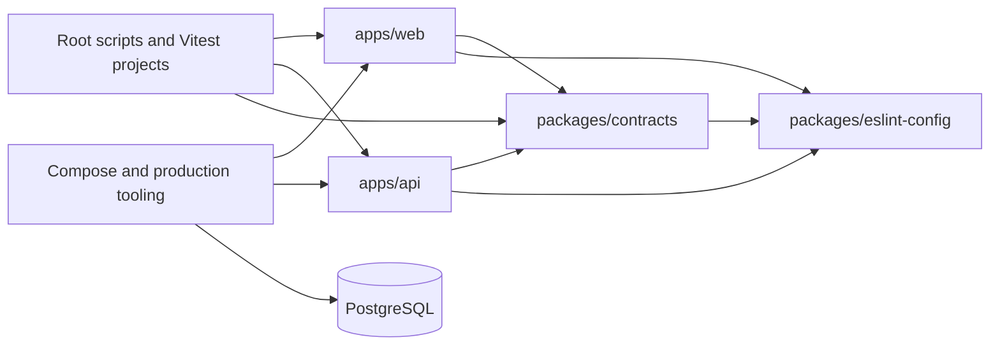

## 4. Repository organization

| Path                          | Responsibility                                                            |
| ----------------------------- | ------------------------------------------------------------------------- |
| `apps/web/src/app`            | Routes, layouts, metadata, redirects, and server-side authentication gate |
| `apps/web/src/features`       | Feature-specific UI and browser API functions                             |
| `apps/web/src/components`     | Shared UI, layout, profile, and theme components                          |
| `apps/web/src/lib`            | API client, configuration, authentication helpers, and error types        |
| `apps/api/src/modules`        | Auth, users, finance, files, feedback, admin, email, and system modules   |
| `apps/api/src/infrastructure` | PostgreSQL, storage, email, analytics, security, logging, and OpenAPI     |
| `apps/api/src/middleware`     | Cross-cutting HTTP security, rate limits, errors, and 404 handling        |
| `packages/contracts`          | Zod transport schemas, public DTO types, identifiers, and constants       |
| `apps/web/messages`           | Versioned translation catalogs for all supported locales                  |
| `docs/adr`                    | Architectural decision records                                            |
| `infrastructure`              | Container defaults and production deploy/backup/update automation         |
| `wiki`                        | Curated entry pages published with maintained technical guides            |

The workspace uses pnpm. The root scripts orchestrate builds, development servers, linting,
typechecking, formatting, database migration, and seeding across packages.

## 5. Backend architecture

### Modular monolith and dependency direction

Each API feature follows the same dependency flow:

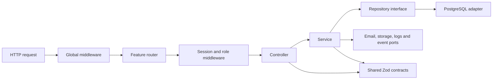

- **Routes** bind URLs and middleware.
- **Controllers** translate Express requests and responses, parse contract schemas, and choose HTTP
  status codes.
- **Services** enforce business rules and authorization without depending on Express.
- **Repository interfaces** define feature-specific persistence operations in domain language.
- **PostgreSQL adapters** implement those interfaces with Drizzle ORM and transactions.

`apps/api/src/composition.ts` is the explicit composition root. It creates repositories and the
local file-storage, email, analytics, and admin-log adapters; injects them into services;
constructs controllers; and supplies session, role, and telemetry middleware. There is no
dependency-injection framework or global service locator.

### Composition map

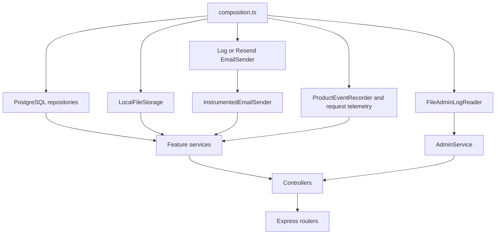

### HTTP pipeline

`createApp` installs middleware in this order:

1. Proxy trust configuration and removal of the Express signature.
2. Helmet security headers and credential-aware CORS with an explicit origin allowlist.
3. Response compression and structured Pino HTTP logging.
4. Size-limited JSON parsing and cookie parsing.
5. General request rate limiting.
6. Request telemetry and health/versioned application routes.
7. Feature-specific authentication and role checks.
8. Not-found handling and centralized error translation.

All versioned endpoints use `/api/v1`. State-changing versioned requests are checked by
`verifyRequestOrigin` against configured allowed origins. Authentication-specific endpoints also
have purpose-specific rate limiters: credential attempts, password recovery, and email verification
each use an independent request bucket with separately configurable limits and windows.

### Modules

#### Auth

Registration normalizes the email, rejects duplicates, hashes passwords with Argon2, creates a
database-backed session, and returns the public user. Login verifies the password and creates the
same kind of session. The raw opaque token is only returned in an HttpOnly cookie; its SHA-256
hash is persisted. Logout marks the session revoked and clears the cookie. Session validation
rejects missing, revoked, or expired rows.

Password-reset requests always return the same accepted response, whether or not the normalized
email belongs to an account. For existing accounts, the API generates an expiring opaque token,
stores only its SHA-256 hash, and sends the raw token in the Resend-hosted reset template. Resetting
atomically consumes the single-use token, invalidates the user's other reset links, changes the
Argon2 password hash, and revokes all existing sessions. The browser also clears its session cookie.

#### Users

The users module exposes the current public profile and profile updates. Internal user records,
including `passwordHash`, are never exported through the shared contract package.

Account state includes verification, forced-password-change, suspension, and role fields. A
suspended account cannot continue using existing sessions. Administrator provisioning creates a
new admin account with a forced first-login password change and deliberately cannot promote an
existing user.

#### Finance

The finance service applies household membership checks to reads and writes. Ownership is a
stronger permission used for member removal and household deletion. Other members may edit basic
household properties and create invitations, transactions, and sources.

Important invariants include:

- A transaction's selected user and source must belong to its household.
- A user may have at most one primary household.
- An owner cannot remove themselves through member removal. When leaving a multi-member household,
  the owner must transfer ownership to another current member.
- A source display key is unique within a household. A source in use by a transaction cannot be
  deleted.
- Source copying requires membership in both the source and target households and skips names
  already present in the target.
- Invitation tokens are stored as hashes, expire, and can only be accepted once.

Income and expenses are separate persistence types but are merged into one
`HouseholdTransaction` transport representation. Amount totals are calculated in integer cents in
the service to avoid binary floating-point errors.

#### Files

The upload route uses Multer memory storage for one file up to the configured limit. It checks the
extension before service execution and inspects the actual bytes/MIME type before persistence.
The service stores generated storage keys rather than client filenames, writes content through the
`FileStorage` interface, and records metadata in PostgreSQL. Every list, metadata, content, and
delete operation is owner-scoped.

The current `LocalFileStorage` adapter is suitable for development and a persistent single-node
volume. An object-storage implementation can replace it at the composition root without changing
the file service.

#### Feedback and email

Authenticated users can submit feedback without learning the destination mailbox. The feedback
service delegates delivery to the automated-email boundary used by registration, verification,
password reset, and household invitations. `InstrumentedEmailSender` records delivery outcomes as
privacy-safe product events around either the local log adapter or the Resend adapter.

#### Admin and analytics

Every `/api/v1/admin` route requires both a valid session and the `admin` role. The admin service
combines aggregate PostgreSQL queries with a bounded reader for retained warning/error/fatal log
files. It exposes overview, health, usage, adoption, retention, reliability, and security views,
plus guarded account suspension. Administrators cannot suspend their own accounts.

Analytics deliberately stay inside the modular monolith:

- domain services emit allowlisted product events for registration, activity, invitations,
  transaction mutations, and email outcomes;
- request middleware asynchronously upserts route-template/status/version latency buckets into
  hourly rollups after a response finishes;
- startup records the deployed application version and timestamp;
- maintenance status records whether pruning and other operational work succeeded; and
- admin queries aggregate analytics and core business tables for selected and comparison ranges.

Event metadata is constrained to approved scalar fields. Raw transaction descriptions, email
addresses, tokens, passwords, uploaded content, and full URLs are not analytics dimensions.

#### System

- `GET /health/live` confirms that the process is running.
- `GET /health/ready` checks dependencies, including database readiness.

At startup the API applies pending migrations before listening, records the deployment, performs
analytics maintenance, and installs graceful shutdown handlers. Readiness is the load-balancer
signal; liveness does not turn a temporary database outage into a restart loop.

### Request, audit, and telemetry flow

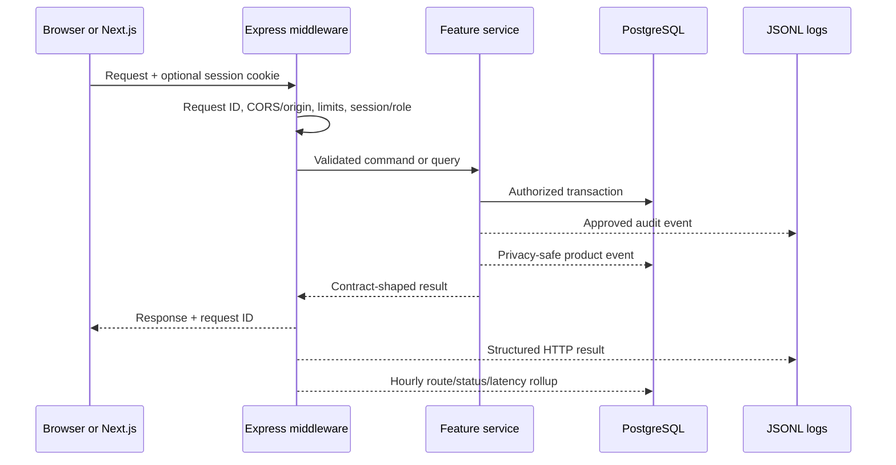

### Error model

Controllers and services throw typed application errors for validation, authentication,
authorization, missing records, and conflicts. The final middleware serializes errors as:

```json
{
  "error": {
    "code": "VALIDATION_ERROR",
    "message": "The submitted data is invalid.",
    "details": { "field": ["Reason"] },
    "requestId": "request-correlation-id"
  }
}
```

Zod, Multer, malformed JSON, and oversized-body errors are mapped into the same envelope.
Unexpected exceptions are logged with their request ID, while the client receives no stack trace
or internal detail.

## 6. Frontend architecture

### Rendering and routing

The App Router divides pages into public and authenticated route groups. The authenticated layout
calls `getServerUser`, forwards the incoming cookie to the API through `API_INTERNAL_URL`, and
redirects unauthenticated requests to `/login`. This prevents protected content from being sent
based only on client-side state.

Principal routes are:

| Route                  | Behavior                                                                            |
| ---------------------- | ----------------------------------------------------------------------------------- |
| `/`                    | Public landing page or the household dashboard, depending on route-group resolution |
| `/login`, `/register`  | Authentication forms with validated safe redirects                                  |
| `/invite/[token]`      | Invitation inspection and acceptance flow                                           |
| `/files`               | Owned-file upload and management                                                    |
| `/graph`               | URL-addressable balance, category, and overview charts for household month ranges   |
| `/admin`               | Role-gated operational, product, reliability, and security analytics                |
| `/settings/profile`    | Public profile appearance fields                                                    |
| `/settings/households` | Household creation, membership, ownership, invitations, and deletion                |
| `/settings/sources`    | Source editing, deletion, and cross-household copy                                  |
| `/settings/appearance` | Local theme and color-mode selection                                                |

`/dashboard`, `/profile`, and `/settings` are compatibility/convenience redirects.

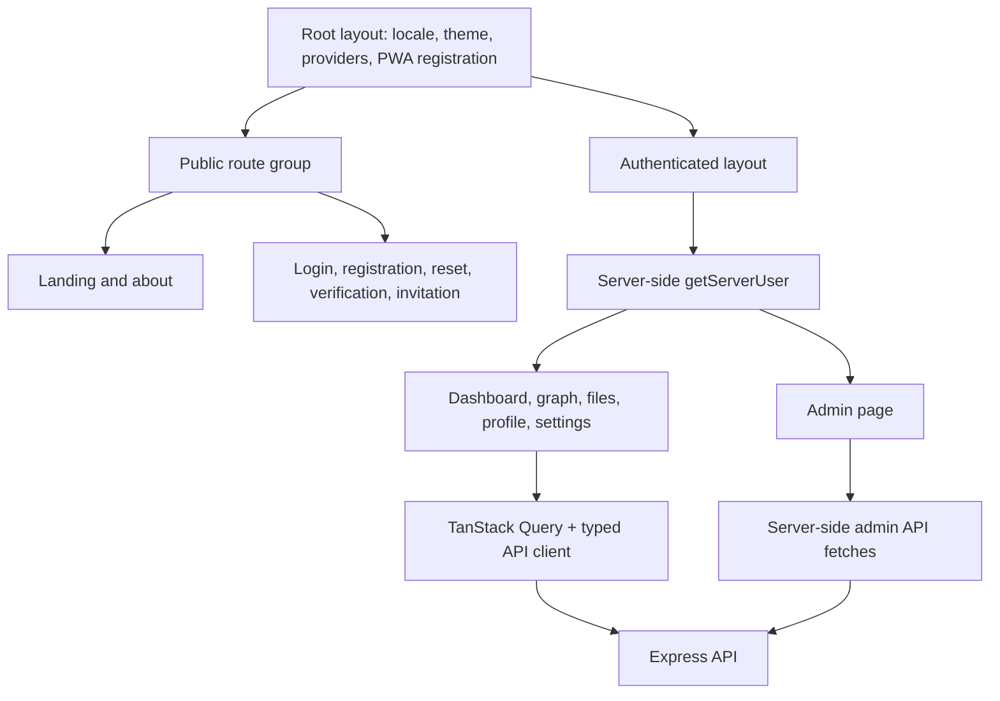

### Server and client state

React Server Components handle the authoritative page gate and initial server-owned concerns.
Interactive features are client components and use TanStack Query for API state. The shared query
client uses a 30-second stale time, one retry, and no focus-triggered refetch. Mutations invalidate
feature query keys so household summaries, settings, and lists converge on server state.

React Hook Form plus Zod resolvers validate authentication and profile forms. Finance forms use
the same shared DTO types and domain constants, with final validation repeated by the API.

The central API client:

- selects `API_INTERNAL_URL` on the server and `NEXT_PUBLIC_API_URL` in the browser;
- prefixes paths with `/api/v1`;
- includes cookies on browser requests and optionally forwards them server-side;
- supports JSON and multipart bodies;
- applies a 10-second default timeout and caller cancellation;
- disables the fetch cache; and
- converts standard API error envelopes into `ApiClientError`.

### Dashboard behavior

The household dashboard loads the household list, selects the primary household by default, and
requests a month aggregate. It can switch household/month, make the selected household primary,
create or edit transactions, and remove transactions with recurrence scope. Sorting and filters
are applied client-side to the returned monthly transaction list; summary cards retain the totals
for the full month, independent of UI filters.

### Graphs behavior

The authenticated `/graph` route keeps the App Router page server-gated while a client leaf owns
validated URL selection, range querying, cent-exact aggregation, and graph controls. One request to
`GET /api/v1/households/:id/transactions?from=YYYY-MM&to=YYYY-MM` returns authorized raw realized
and projected transactions for inclusive whole-month bounds. The browser derives balance,
expense-category, and radar-overview models without storing chart output on the server.

Recharts is loaded behind a graph-only dynamic boundary so it does not enter Home's route bundle.
Every chart supplies a localized summary, keyboard-accessible tooltip navigation, explicit
realized/projected styling, and a semantic exact-value table. Period and graph changes retain URL
history, while TanStack Query caches data by household and month range.

### Appearance

Theme ID, light/dark mode, and the optional dark header for light mode are stored in browser
`localStorage`. A small script in the root document head applies the stored data attributes before
React hydration to limit a flash of the default theme. The preference is device/browser-local and
is not synchronized through the API.

### Localization, PWA, and accessibility

`next-intl` loads one of five checked message catalogs using a locale cookie, with English as the
fallback. API error codes are translated at the web boundary; the server remains locale-neutral.
The generated manifest, icons, service-worker registration, and static `offline.html` provide the
installable/offline shell. The service worker does not cache authenticated API data as an offline
source of truth.

Charts include exact-value tables and keyboard-accessible tooltips. Forms expose labels and field
errors, motion utilities respect reduced-motion preferences, and server authentication prevents a
flash of protected content.

## 7. Shared contracts and validation

`@monthloom/contracts` is the transport boundary between frontend and backend. It contains Zod
schemas and inferred TypeScript types for requests, responses, public entities, pagination,
errors, health checks, and shared enum-like constants. It intentionally excludes ORM rows,
password hashes, session tokens, repositories, and services.

Request schemas encode domain validation such as:

- UUID identifiers, ISO timestamps, calendar dates, and `YYYY-MM` month keys;
- three-letter uppercase currency codes and six-digit hexadecimal colors;
- positive decimal amounts with at most two fractional digits;
- expense-category requirements and their exclusion from income;
- recurrence expiration not preceding the entry date; and
- valid, non-duplicated recurring-series selections and source selections.

Sharing these schemas detects drift at build time, while parsing again at the API boundary keeps
the server authoritative for untrusted input.

## 8. Data model

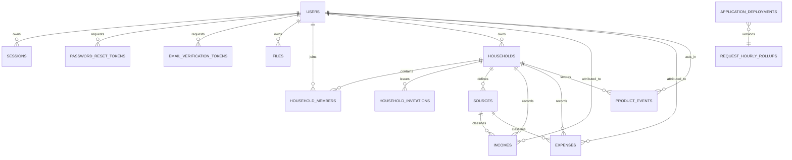

| Table                       | Key data and constraints                                                 |
| --------------------------- | ------------------------------------------------------------------------ |
| `users`                     | Normalized unique email, Argon2 hash, display/profile fields, role       |
| `sessions`                  | Unique token hash, expiry, revocation timestamp, cascading user FK       |
| `password_reset_tokens`     | Unique token hash, expiry, single-use timestamp, cascading user FK       |
| `email_verification_tokens` | Hashed, expiring, single-use verification credentials                    |
| `files`                     | Owner, generated unique storage key, original name, MIME type, byte size |
| `households`                | Currency, visual identity, owner; owner deletion is restricted           |
| `household_members`         | Composite household/user key, join time, per-user primary flag           |
| `household_invitations`     | Unique token hash, creator, expiry, acceptance audit fields              |
| `sources`                   | Household-scoped unique normalized key and aliases                       |
| `incomes`                   | Positive numeric amount, member, source, date, recurrence metadata       |
| `expenses`                  | Income fields plus a required expense category                           |
| `recurrence_exclusions`     | Suppressed projected dates for edited/deleted recurring occurrences      |
| `product_events`            | Privacy-safe lifecycle events and constrained aggregate dimensions       |
| `request_hourly_rollups`    | Route-template/status/version latency and request-count buckets          |
| `operational_status`        | Last attempt/success state for background maintenance                    |
| `application_deployments`   | Immutable application version and deployment-time observations           |

Database checks reinforce currency/color formats, positive amounts, and source alias rules. A
partial unique index on `household_members.user_id` where `is_primary` is true enforces the single
primary-household invariant. Composite source foreign keys prevent transactions from referring to
a source in another household.

Schema migrations are generated and tracked under
`apps/api/src/infrastructure/database/migrations`. The API startup lifecycle applies them before
opening the listener; explicit `pnpm db:migrate` remains useful for local setup and operational
verification. Production migrations must stay backward-compatible because application-image
rollback cannot reverse database changes.

## 9. Recurring transaction model

Recurring entries share a `recurrenceId`; materialized occurrences remain ordinary income or
expense rows. Future month reads also synthesize projections:

1. Load actual rows in the requested month.
2. For future months only, load earlier recurring history and group it by recurrence ID.
3. Skip a series that already has an actual occurrence in the requested month.
4. Use the latest series metadata, align its day into the requested month, and stop after
   `expiresOn`.
5. Estimate the projected amount from up to the six most recent occurrences and mark the returned
   DTO with `projected: true`.

Past and current months never contain synthetic rows. Update operations accept explicit booleans
for past, current, and future occurrences, allowing non-contiguous selection. Delete operations
use the simpler scopes `current`, `current_and_future`, or `past_current_and_future`. Repository
transactions keep cross-table kind changes and multi-occurrence edits atomic.

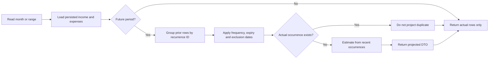

## 10. Primary request flows

### Authenticated browser request

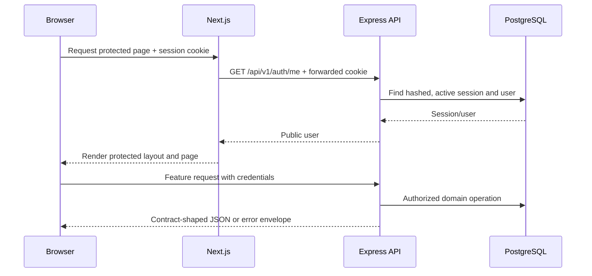

### Authentication and account-state flow

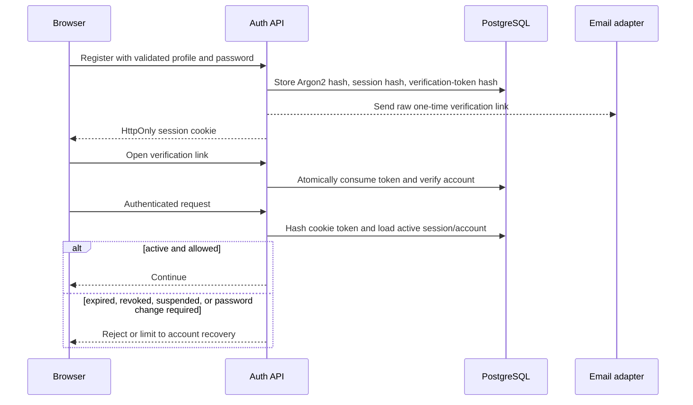

### Invitation flow

Any household member may create a shareable invitation link or send invitations to as many as 20
comma-separated email recipients at once. Every recipient gets a separate single-use token and
link. The API stores only token hashes; raw tokens are returned for shareable links or sent inside
transactional email. The public invitation lookup validates existence, unused state, and expiry
without requiring authentication. Acceptance requires a session, atomically adds membership and
marks the invitation accepted, and rejects reused, expired, or already-member cases. If an email
delivery fails, only that recipient's newly created invitation is removed, and the response reports
successful and failed recipients separately for safe retry handling.

### Email delivery

Automated email is composed centrally as plain text and responsive HTML, then sent through an
`EmailSender` infrastructure interface. The Resend adapter uses the official Node.js SDK and a
backend-only API key; a log adapter is the safe local default and records recipient/subject
metadata without leaking token-bearing message bodies. Account verification, password reset,
household invitation, and monthly report templates are available, while each feature remains
responsible for token lifecycle and scheduling. Configure `EMAIL_TRANSPORT=resend`, a verified
sending-domain address, and `RESEND_API_KEY` to enable real delivery.

The five published Resend templates use stable aliases (`monthloom-welcome`,
`monthloom-email-verification`, `monthloom-password-reset`, `monthloom-household-invitation`, and
`monthloom-monthly-balance`). Their versioned definitions live in the repository and can be safely
created or updated with `pnpm email:templates:sync`. Registration sends the welcome template with a
single-use email verification link. Unverified users can request another verification email from
profile settings; password recovery and email invitations remain unavailable until verification.
Welcome delivery remains a non-critical side effect; a failure is logged but never invalidates the
newly created account. The monthly-balance template is intentionally retained but dormant:
`AutomatedEmailService.sendMonthlyReport` is ready for a future scheduled monthly-report job. See
the [runtime configuration guide](runtime-configuration.md) for the audited invocation status of
all five templates.

Template synchronization prefers the optional full-access `RESEND_ADMIN_KEY` and falls back to
`RESEND_API_KEY`. The admin key is a provisioning credential and should not be configured in the
production application; runtime delivery only needs a sending-access `RESEND_API_KEY`.

### File upload flow

The API receives a single in-memory multipart part, checks configured size/type rules, derives a
safe storage key, writes bytes through `FileStorage`, and then persists owner-scoped metadata. The
service compensates for metadata failure by removing newly written binary content. Downloads
resolve metadata ownership before opening the stored content.

## 11. API surface

The major route groups are:

| Base path            | Operations                                                                                   |
| -------------------- | -------------------------------------------------------------------------------------------- |
| `/api/v1/auth`       | Register, login, logout, password reset, current session user                                |
| `/api/v1/users`      | Read and update the current profile                                                          |
| `/api/v1/households` | Household CRUD, primary selection, members, invitations, monthly/range transactions, sources |
| `/api/v1/files`      | Upload, list, metadata, content, delete                                                      |
| `/api/v1/feedback`   | Deliver authenticated product feedback                                                       |
| `/api/v1/admin`      | Admin-only overview, analytics, reliability, security, and account suspension                |
| `/health`            | Liveness and readiness                                                                       |

The generated OpenAPI 3.0 document is served at `/api/v1/openapi.json`. In development, Swagger
UI is mounted at `/api/docs`; the interactive UI is not exposed in production. Compact registrations
live beside each API module and reuse the shared Zod transport schemas. A test compares every Express
method/path declaration with the generated document, making undocumented or stale routes a CI failure.
The contract is maintained for Monthloom clients, including possible future native or standalone
frontends, but is not currently a third-party compatibility promise.

## 12. Security model

- Passwords are hashed with Argon2.
- Session tokens are cryptographically random, opaque, hashed at rest, expiring, and revocable.
- Password-reset tokens are random, hashed at rest, expire after one hour, and are consumed once.
- Email-verification and invitation tokens use the same hash-at-rest, expiry, and single-use model.
- Session cookies are `HttpOnly`, `SameSite=Lax`, path-scoped to `/`, and `Secure` when configured.
- Authenticated CORS uses explicit origins and credentials; write requests additionally verify
  `Origin` as CSRF defense in depth.
- Server-side protected layouts never trust client query state as an authorization decision.
- Services enforce record ownership and household membership; UI visibility is not a security
  boundary.
- Helmet, request/body/upload limits, authentication throttling, and general rate limiting reduce
  common HTTP attack surface.
- Upload validation checks actual content type and isolates storage names from user filenames.
- Error responses omit stack traces and carry correlation IDs for server-side investigation.
- Environment variables are parsed with Zod and invalid configuration fails startup.
- Administrator APIs require both authentication and an explicit database-backed role; suspended
  accounts and forced-password-change accounts are rejected at the session boundary.
- Audit and analytics records use allowlisted fields and avoid secrets and raw finance content.

Household membership and ownership remain the authorization boundaries for finance data. The
administrator role gives access to aggregate operational views and account suspension, not an
implicit bypass into a household's transaction details or uploaded files.

## 13. Configuration and operation

Requirements are Node.js 20.11+, pnpm 9+, and PostgreSQL 16 for the supplied Compose setup. Copy
`.env.example` to `.env` and provide real secrets before starting the applications.

Common commands from the repository root:

```bash
pnpm install
pnpm docker:up
pnpm db:migrate
pnpm db:seed       # development only
pnpm dev

pnpm typecheck
pnpm lint
pnpm build
```

Docker Compose starts PostgreSQL, the API on port 4000, and the web app on port 3000. It uses named
volumes for database, upload, and API-log persistence and waits for service health before starting
dependents. `API_INTERNAL_URL` lets the Next.js server address the API by its container hostname,
while `NEXT_PUBLIC_API_URL` must be reachable by the visitor's browser.

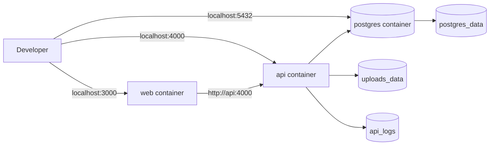

Structured operational, HTTP, and approved audit records go through Pino into daily UTC JSONL
files. Request IDs connect HTTP responses with operational and audit records. Production keeps logs
in a dedicated named volume with 90-day retention; see
[`server-logging.md`](./server-logging.md). Metrics, distributed traces, hosted error reporting, and
alerting are not currently included. The complete variable inventory, ownership rules, defaults,
and workflow-to-Compose mapping live in [`runtime-configuration.md`](./runtime-configuration.md).

### Production deployment topology

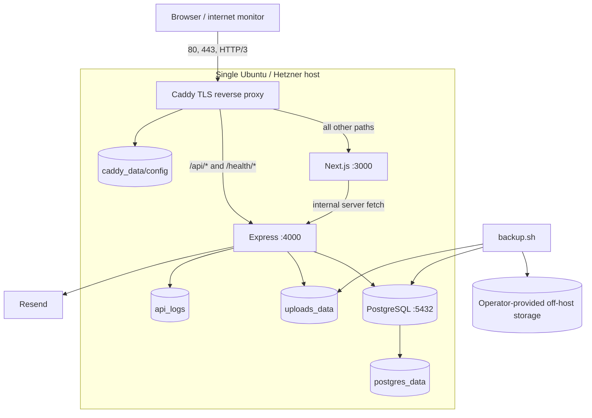

Only Caddy publishes host ports. The frontend network joins Caddy, web, and API; an internal
backend network joins API and PostgreSQL. Database, API, and web ports remain private. This is a
durable single-node layout, not a highly available one.

### Build, release, update, and rollback flow

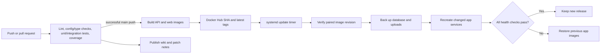

The updater can roll application images back, but it cannot reverse migrations. Deployment-file
changes are intentionally manual: operators pull the repository and reconcile the private
production Compose file separately from automatic image updates.

## 14. Testing and production boundaries

Vitest projects cover shared contracts, API and web units, and API/web integration behavior.
API integration tests use an isolated PostgreSQL database and run real migrations. CI installs
locked dependencies, lints, checks environment-schema drift, type-checks production and test code,
runs tests with coverage thresholds, and retains JUnit/coverage artifacts. OpenAPI tests compare
registered Express method/path pairs with the generated document.

The repository does not currently include browser-driven end-to-end tests, load tests, or a
multi-host disaster-recovery test. Production remains bounded by:

- a single host for Caddy, applications, PostgreSQL, uploads, and local logs;
- operator-managed off-host backup copying, retention, alerting, and restore drills;
- local filesystem uploads, which prevent horizontal API scaling without a storage-adapter change;
- application-image rollback that cannot undo a destructive database migration;
- no centralized log shipping, distributed tracing, hosted error reporting, or external alerting;
- sender-domain, bounce, and complaint operations delegated to the Resend account; and
- no malware scanning pipeline for uploaded images.

See [`production-concerns.md`](./production-concerns.md) for the maintained deployment checklist.

## 15. Extension points

- Add a storage provider by implementing `FileStorage` and changing the composition root.
- Add persistence implementations by satisfying the feature-specific repository interface.
- Add a backend feature as a route/controller/service/repository module and register it in
  `composition.ts` and `routes.ts`.
- Add transport types only to `packages/contracts`; keep internal domain and database types in the
  API.
- Extend the OpenAPI registry whenever a route is introduced or changed.
- Add frontend functionality under a feature directory with a typed API module and scoped TanStack
  Query keys.
