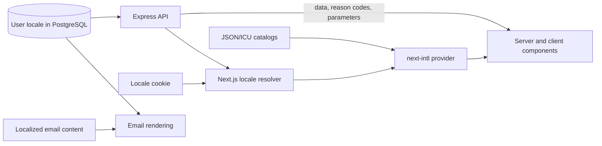

# Localization implementation plan

## Purpose

This plan introduces user-selected localization to Monthloom without coupling the API or future
applications to the Next.js translation layer. The first supported locales are English (`en`),
Albanian (`sq`), French (`fr`), and Turkish (`tr`), with English as the default and fallback.

The web application will use `next-intl`. Shared contracts and the API will expose locale values,
locale-neutral data, and machine-readable outcomes. Each phase below should be independently
reviewable and leave the application deployable.

## Agreed decisions

- Store a user's locale on their profile.
- Use `en`, `sq`, `fr`, and `tr` as BCP 47 locale identifiers.
- Use English when no saved or remembered preference exists.
- Resolve the locale in this order: authenticated user profile, locale cookie, English.
- Keep authenticated URLs locale-neutral; do not introduce `/en`, `/fr`, `/sq`, or `/tr` routes.
- Use JSON/ICU message catalogs organized by feature.
- Keep locale, household currency, and timezone as separate concepts.
- Keep API contracts independent of `next-intl` and web catalog keys.
- Retain English API messages as diagnostic fallbacks while clients use stable reason codes.
- Do not add a translation-management service or shared cross-application catalog package yet.

## Target architecture



The API must not return web translation keys. A future application should be able to translate API
reason codes with its own localization library and catalogs.

## Phase 1: Add the locale contract and persistence

- [ ] Add `SUPPORTED_LOCALES = ['en', 'sq', 'fr', 'tr']` to the shared contracts.
- [ ] Export a Zod `localeSchema` and inferred `Locale` type.
- [ ] Add `USER_LOCALE = 'en'` to `Defaults`.
- [ ] Add a non-null `locale` varchar column with an `en` default to the users table.
- [ ] Generate and review a Drizzle migration; existing users must receive `en`.
- [ ] Add `locale` to `User`, `CreateUserData`, and `UpdateUserData` in the API.
- [ ] Add `locale` to `PublicUser` and `UpdateProfileRequest` in the shared contracts.
- [ ] Update the PostgreSQL user adapter and `toPublicUser` serialization.
- [ ] Update API/OpenAPI schemas, user fixtures, mocks, and typed test users.
- [ ] Add contract tests for all supported locales and rejection of unsupported values.
- [ ] Add an API integration test proving that an updated locale persists and appears in `/auth/me`.

Use a varchar rather than a PostgreSQL enum because supported languages are expected to grow. The
shared schema remains the application-level allowlist.

Likely files:

- `packages/contracts/src/constants.ts`
- `packages/contracts/src/defaults.ts`
- `packages/contracts/src/users/user.schemas.ts`
- `apps/api/src/infrastructure/database/schema/identity.ts`
- `apps/api/src/modules/users/user.types.ts`
- `apps/api/src/modules/users/user.service.ts`
- `apps/api/src/modules/users/adapters/postgres-user.repository.ts`
- User, auth, contract, and integration test fixtures

Acceptance criteria:

- Existing users remain valid and default to English after migration.
- The API accepts only the four supported locale values.
- The selected locale survives logout, login, and API restarts because it is stored on the user.

## Phase 2: Configure `next-intl` in the web application

- [ ] Add `next-intl` to `apps/web`.
- [ ] Enable the `next-intl` plugin in `apps/web/next.config.mjs`.
- [ ] Create `apps/web/src/i18n/config.ts` with supported locales and the fallback locale.
- [ ] Create `apps/web/src/i18n/request.ts` to resolve the locale and load its catalog.
- [ ] Create initial `en.json`, `sq.json`, `fr.json`, and `tr.json` catalogs.
- [ ] Organize messages into feature namespaces such as `Common`, `Auth`, `Profile`, and `Finance`.
- [ ] Cache `getServerUser()` per request so root and nested layouts do not duplicate `/auth/me`.
- [ ] Wrap the application with `NextIntlClientProvider` in the root layout.
- [ ] Set `<html lang>` from the resolved locale rather than hard-coding `en`.
- [ ] Load only the selected locale's messages for a request.
- [ ] Update the web test render helper to provide an English internationalization context.
- [ ] Add one server-rendered and one client-rendered translation test.

Locale resolution:

```text
authenticated user.locale
-> monthloom-locale cookie
-> en
```

Proposed catalog layout:

```text
apps/web/messages/
  en.json
  sq.json
  fr.json
  tr.json
```

Acceptance criteria:

- Existing English pages render as before through translation keys.
- Server and client components can both resolve messages.
- The initial HTML has the correct `lang` attribute and does not flash English first.
- No locale prefix is added to application URLs.

## Phase 3: Add profile selection and preference synchronization

- [ ] Add a language field to the profile form.
- [ ] Display language names in their own language: English, Shqip, Français, Türkçe.
- [ ] Include the selected locale in the existing profile update request.
- [ ] On success, update or invalidate the current-user query.
- [ ] Write `monthloom-locale=<locale>` with `Path=/`, `SameSite=Lax`, and a long lifetime.
- [ ] Refresh the Next.js router so Server Components, metadata, providers, and `<html lang>` update.
- [ ] Synchronize the locale cookie from `user.locale` after login.
- [ ] Keep the locale cookie after logout so public pages retain the last preference.
- [ ] Add integration tests for changing the locale and retaining it across refresh and login.

The cookie is a non-sensitive presentation preference and does not need to be `HttpOnly`. The user
record is authoritative while authenticated; the cookie supports the first request and logged-out
pages.

Likely files:

- `apps/web/src/features/users/profile-form.tsx`
- `apps/web/src/features/auth/login-form.tsx`
- `apps/web/src/features/auth/register-form.tsx`
- `apps/web/src/i18n/locale-cookie.ts`
- Profile and auth integration tests

Acceptance criteria:

- Changing the profile language updates the page immediately.
- Refreshing or signing in again preserves the selected language.
- A missing, malformed, or unsupported cookie safely falls back to English.

## Phase 4: Migrate all web presentation strings

Migrate by feature so each pull request remains reviewable:

- [ ] Shared shell: header, navigation, settings navigation, common controls, and app information.
- [ ] Authentication: login, registration, password reset, and email verification.
- [ ] User features: profile, appearance, password change, and feedback.
- [ ] Files: upload, file list, empty states, and errors.
- [ ] Household settings: membership, invitations, sources, and ownership actions.
- [ ] Transactions: forms, recurrence, icons, colors, source selection, and confirmations.
- [ ] Dashboard: summaries, month navigation, filters, sorting, table labels, and empty states.
- [ ] Onboarding and PWA installation prompts.
- [ ] Loading, not-found, route error, and global error states.
- [ ] Page metadata and manifest descriptions where runtime localization is supported.

Each feature migration must include:

- [ ] Visible labels, headings, body copy, buttons, and links.
- [ ] Alerts, success messages, confirmations, and empty states.
- [ ] Placeholders and helper text.
- [ ] `aria-label`, `title`, and meaningful `alt` text.
- [ ] Interpolated strings and plural forms expressed as ICU messages.
- [ ] Display labels for stable enum values such as expense types, recurrence units, icons, colors,
      and profile-image keys.

Stored identifiers such as `expense`, `month`, and `diamond-kilim` must remain unchanged. Move their
English display labels out of shared constants and into the web catalogs.

Example ICU messages:

```json
{
  "stepProgress": "Step {current} of {total}",
  "transactions": "{count, plural, =0 {No transactions} one {# transaction} other {# transactions}}"
}
```

Acceptance criteria:

- The UI contains no first-party English prose outside message catalogs, except diagnostic logs and
  explicitly documented technical values.
- All interactive controls have localized accessible names.
- Dynamic sentences use locale-correct interpolation and pluralization.
- User content, file names, brand names, currency codes, and stored identifiers are not translated.

## Phase 5: Make formatting and text operations locale-aware

- [ ] Replace `Intl.DateTimeFormat(undefined, ...)` with `next-intl` formatters or an explicit
      selected locale.
- [ ] Replace `Intl.NumberFormat(undefined, ...)` in financial displays.
- [ ] Replace locale-implicit `Intl.Collator` instances used for displayed sorting.
- [ ] Format month labels, transaction dates, and summaries with the selected locale.
- [ ] Continue using the household's configured currency when formatting money.
- [ ] Pass the selected locale when case-folding user-facing search text, especially for Turkish.
- [ ] Keep deliberately locale-independent domain normalization unchanged.
- [ ] Add representative tests for dates, money, sorting, search, and pluralization.

Likely hotspots:

- `apps/web/src/features/finance/household-dashboard.tsx`
- `apps/web/src/features/finance/transaction-form.tsx`
- `apps/web/src/features/finance/dashboard/summary.tsx`
- `apps/web/src/features/finance/dashboard/transaction-view.ts`

Acceptance criteria:

- Dates and month names follow the selected locale.
- Money uses locale-specific punctuation while retaining the household currency.
- Turkish text search and sorting behave correctly for Turkish users.

## Phase 6: Make API errors and validation client-translatable

The web app currently displays API `message` values and validation detail strings directly. These
must become fallbacks rather than the primary client contract.

- [ ] Add an optional stable `reason` and optional `params` to the API error body.
- [ ] Define shared reason-code types for user-facing API failures.
- [ ] Preserve `code` as the broad HTTP error category.
- [ ] Preserve the English `message` for logging, diagnostics, and older clients.
- [ ] Give shared Zod validation failures stable machine-readable reason codes.
- [ ] Map API and validation reasons to web catalog messages.
- [ ] Stop displaying `ApiClientError.message` directly in components.
- [ ] Display a localized generic fallback when a reason is absent or unknown.
- [ ] Translate success states from the operation performed instead of rendering API response prose.
- [ ] Update auth, users, finance, files, feedback, middleware, contracts, and OpenAPI documentation.
- [ ] Add tests for known reason mapping, interpolation parameters, and unknown-reason fallback.

Example response:

```json
{
  "error": {
    "code": "VALIDATION_ERROR",
    "reason": "CURRENT_PASSWORD_INCORRECT",
    "params": {},
    "message": "Current password is incorrect."
  }
}
```

The API must use stable domain codes such as `CURRENT_PASSWORD_INCORRECT`, not web keys such as
`Profile.password.errors.incorrect`.

Acceptance criteria:

- No user-facing web component renders raw API prose.
- Existing API clients can continue reading `message` during the transition.
- A future client can translate `reason` without importing Monthloom's web catalogs.
- Unknown errors remain understandable through a localized generic message.

## Phase 7: Localize user-facing email

- [ ] Add locale-specific content for welcome, verification, password reset, invitation, and monthly
      balance emails.
- [ ] Select the stored recipient locale for emails associated with an existing user.
- [ ] Use the inviting user's locale for an invitation recipient without an account.
- [ ] Localize subjects, previews, headings, body text, buttons, and automated-message footers.
- [ ] Set the email HTML `lang` attribute.
- [ ] Format email dates, expiry times, month labels, and money using the selected locale.
- [ ] Generate and synchronize locale-specific Resend aliases, for example
      `monthloom-password-reset-fr`.
- [ ] Keep internal feedback notifications in operational English unless an operator preference is
      introduced later.
- [ ] Add unit tests for locale selection and representative rendered email content.
- [ ] Verify the template synchronization command handles every supported locale.

Likely files:

- `apps/api/src/modules/email/resend-template-definitions.ts`
- `apps/api/src/infrastructure/email/sync-resend-templates.ts`
- Auth and finance services that prepare email messages
- Email tests

Acceptance criteria:

- User-facing transactional email follows the selected or defined fallback locale.
- Links and dynamic values remain intact in all localized templates.
- Adding a locale has an explicit email-template checklist item.

## Cross-cutting verification

- [ ] Add a catalog-parity test that compares every locale's keys with `en.json`.
- [ ] Fail validation for missing, extra, or malformed ICU messages.
- [ ] Add TypeScript message-key augmentation where it improves call-site safety.
- [ ] Audit hard-coded web strings with `rg` after every feature migration.
- [ ] Test at least one locale with longer text and verify narrow layouts do not clip controls.
- [ ] Verify keyboard and screen-reader labels in each locale.
- [ ] Run `pnpm typecheck`.
- [ ] Run `pnpm lint`.
- [ ] Run contract, API, and web tests.
- [ ] Run the production build.

## Definition of done

- [ ] English, Albanian, French, and Turkish can be selected from profile settings.
- [ ] The selected locale persists in the database and is restored on the first authenticated render.
- [ ] The application does not flash English before rendering the selected locale.
- [ ] `<html lang>` and localized metadata match the active locale.
- [ ] All first-party UI and accessibility strings come from catalogs.
- [ ] Dates, numbers, money, pluralization, sorting, and user-facing search honor the active locale.
- [ ] Raw API prose is never presented as the primary user-facing message.
- [ ] User-facing transactional email uses the appropriate locale.
- [ ] Every catalog has the same keys and valid ICU syntax.
- [ ] Typecheck, lint, tests, and production build pass.

## Deferred work

The following work should be added only when a concrete need appears:

- Locale-prefixed public routes for localized SEO and shareable public URLs.
- Automatic `Accept-Language` detection for visitors with no remembered preference.
- Right-to-left layout support when an RTL locale is selected for implementation.
- A translation-management service and translator workflow.
- A shared catalog package for another application.
- Native mobile catalog conversion and compatibility checks.
- Per-user timezone settings.

## Known risks

- API error localization is the broadest phase because services and shared Zod schemas currently
  carry English prose.
- `global-error.tsx` renders outside the normal provider when the root layout fails; it needs a small
  self-contained locale fallback based on the synchronized cookie.
- Installed PWA manifest metadata may remain cached after a user changes language.
- Albanian, French, and Turkish translations require human review for financial terminology and
  natural phrasing before release.
