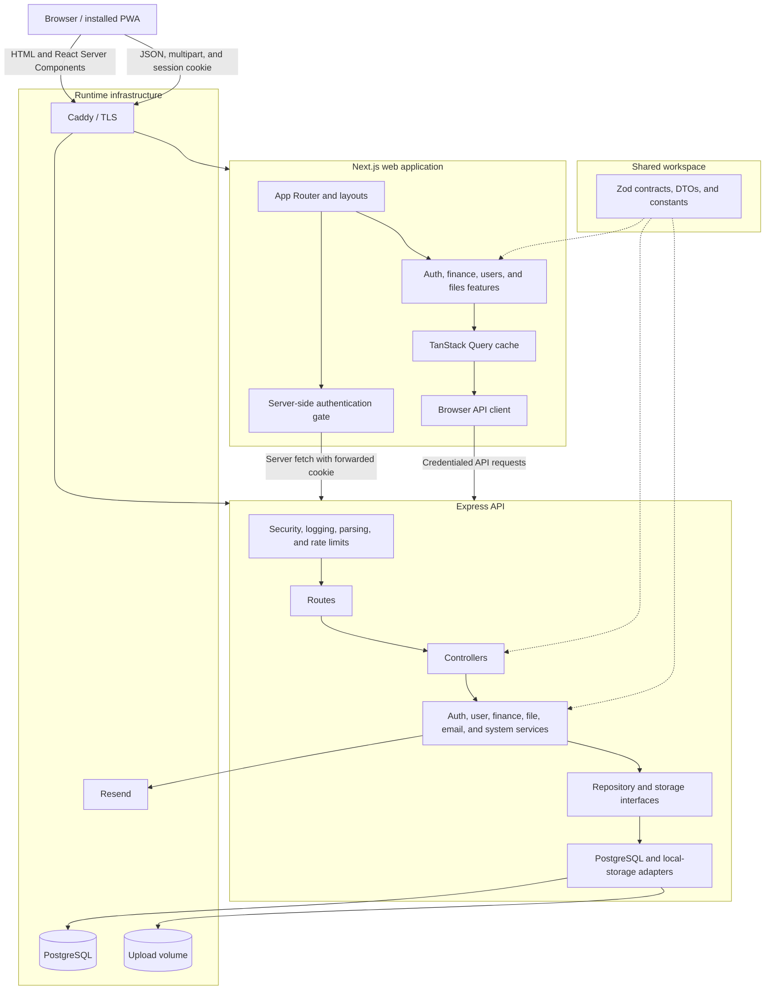
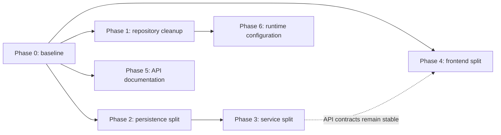

# Monthloom refactoring plan

## Purpose

Monthloom started from a general-purpose application template. Its current architecture is sound,
but some template residue and several oversized finance files make the application harder to read,
maintain, and extend than necessary.

This plan is deliberately divided into independently deliverable phases. Each phase has its own
scope, justification, validation gate, and completion criteria. A phase should leave the main branch
deployable; later phases must not be required to make an earlier phase safe.

The plan favors incremental simplification over a rewrite. It keeps the existing Next.js web app,
Express API, PostgreSQL/Drizzle persistence, shared Zod contracts, and modular-monolith deployment
model.

## Current architecture



## Refactoring principles

1. Preserve externally visible behavior unless a phase explicitly defines a product change.
2. Keep every phase reviewable and deployable on its own.
3. Add characterization tests before moving complex recurrence, authorization, or ownership logic.
4. Split code by business capability, not merely to meet a line-count target.
5. Keep transaction boundaries explicit when persistence code is divided.
6. Delete an abstraction only when it has no current purpose or realistic near-term use.
7. Avoid introducing a dependency-injection framework, microservices, or a new application stack.
8. Measure improvements with file size, dependency count, test duration, build output, and coverage,
   rather than relying only on subjective impressions.

## Areas intentionally retained

The following are useful boundaries rather than unnecessary bloat:

- Separate web and API deployables.
- Shared Zod transport contracts.
- The explicit API composition root.
- Service-level authorization and business rules.
- Repository interfaces around database access.
- The `FileStorage` interface, because production storage is expected to replace local disk.
- The email sender interface, because log and Resend transports are both useful.
- Central HTTP error translation, origin checks, rate limits, and security middleware.
- Integer-cent monetary calculations and database-enforced constraints.

## Phase 0: establish a refactoring baseline

### Goal

Create a reliable safety net and record the state against which later simplification can be judged.

### Justification

Finance recurrence, invitations, membership, and ownership transfer contain behavior that can be
silently changed by structural work. A baseline makes the later phases mechanical and lets each
phase demonstrate that it has not altered behavior.

### Tasks

- [x] Run and record `pnpm lint`.
- [x] Run and record `pnpm typecheck` and `pnpm test:typecheck`.
- [x] Start the isolated test database and run all unit and integration tests.
- [x] Run both production application builds.
- [x] Record test duration, coverage, build duration, dependency count, and largest source files.
- [x] Add characterization tests where current behavior is not adequately protected:
  - [x] Creating, editing, and deleting one occurrence of a recurring transaction.
  - [x] Editing and deleting future occurrences and complete series.
  - [x] Projecting recurring transactions into a future month.
  - [x] Household ownership transfer when an owner leaves.
  - [x] Invitation expiry, single use, and email-sender verification restrictions.
  - [x] Source copying, name normalization, duplicate handling, and deletion while in use.
  - [x] Membership checks for household reads and writes.
- [x] Add or configure an import-boundary check so application layers cannot import infrastructure
      adapters directly, except from the composition root.

### Recorded baseline (2026-10-15)

The baseline was captured on Windows with Node 22 and pnpm 9.7.0. PostgreSQL 16 ran in the
isolated `compose.test.yml` container. Production images were built in Linux containers, which is
the deployed build environment.

| Measurement | Result |
|---|---:|
| Lint | Passed in 7.64 s; 0 errors and 3 pre-existing web warnings |
| Production type check | Passed in 4.31 s |
| Test type check | Passed in 5.41 s |
| Full test suite with coverage | 106 tests in 19 files passed; command completed in 7.30 s |
| Statement coverage | 63.40% |
| Branch coverage | 79.69% |
| Function coverage | 74.38% |
| Line coverage | 63.40% |
| API production build | Passed locally in 3.41 s |
| API and web Docker production builds | Passed together in 69.77 s from a cold dependency layer |
| Unique direct dependencies | 61 total: 32 production and 29 development |

The native Windows Next.js build compiled, type-checked, and generated all 17 routes, but its
standalone-output copy failed because the host did not permit pnpm symlink creation (`EPERM`). The
same web production build completed successfully in the Linux Docker image. This is recorded as a
host-environment limitation rather than an application build failure.

The ten largest TypeScript production files at baseline were:

| Lines | File |
|---:|---|
| 1,021 | `apps/api/src/modules/finance/adapters/postgres-finance.repository.ts` |
| 773 | `apps/web/src/features/finance/household-dashboard.tsx` |
| 641 | `apps/api/src/infrastructure/openapi/document.ts` |
| 584 | `apps/web/src/features/finance/transaction-form.tsx` |
| 577 | `apps/web/src/features/finance/household-settings.tsx` |
| 439 | `apps/web/src/components/onboarding/onboarding-tour.tsx` |
| 432 | `apps/api/src/modules/finance/finance.service.ts` |
| 393 | `apps/api/src/infrastructure/database/schema.ts` |
| 373 | `apps/web/src/features/finance/source-settings.tsx` |
| 296 | `packages/contracts/src/finance/household.schemas.ts` |

Invitation tokens are intentionally bearer tokens in the current implementation: invitations do
not persist an intended recipient, even when delivery uses email. Phase 0 therefore characterizes
expiry, single use, existing-member rejection, and the requirement that an inviter verify their
email before email delivery. Binding acceptance to a recipient would be a product and schema
change, not a behavior-preserving test addition.

### Validation gate

- All existing and new tests pass.
- Both applications build successfully.
- Baseline measurements are committed to the pull request or recorded in this document.
- No production behavior changes are included in the phase.

### Completion result

Later phases can move code with confidence and can compare their effect with a known baseline.

---

## Phase 1: remove confirmed template and repository residue

### Goal

Remove files, names, packages, and generated artifacts that do not contribute to the running
application.

### Justification

This is the lowest-risk simplification. It reduces cognitive load, repository size, and confusing
package behavior before any domain code is changed.

### Tasks

- [x] Rename legacy template-scoped packages to `@monthloom/*` throughout package manifests,
      imports, scripts, Dockerfiles, documentation, and test aliases.
- [x] Replace remaining template-named default database values where backward compatibility does
      not require retaining them.
- [x] Delete `package-lock.json`; `pnpm-lock.yaml` is the workspace lockfile.
- [x] Confirm that `packages/config` has no consumers, then delete it and remove it from workspace
      concerns.
- [x] Remove the root `postinstall` contract build. Make contract compilation an explicit part of
      build scripts, or expose workspace source/types in a way supported by both applications.
- [x] Ensure `.pnpm-store`, `.next`, `coverage`, and `test-results` are ignored and not tracked.
- [x] Stop tracking `apps/api/cookies.txt`. Before deletion, inspect it locally for active session
      material and revoke or rotate affected credentials if necessary.
- [x] Stop tracking files below `apps/api/uploads`; retain only `.gitkeep` if the directory is
      useful for local setup.
- [x] Audit dependencies with a dependency-analysis tool and manual verification. Remove only
      dependencies confirmed unused in application, test, build, migration, and maintenance paths.
- [x] Decide how source design assets are managed:
  - [x] Keep only assets shipped by the app, editable SVG logo sources, or documentation assets in
        the main repository.
  - [x] Remove generated size variants from the main repository; no separate artifact store is
        currently needed because the retained SVG files are the editable masters.
  - [x] Document that runtime icon variants should be regenerated from SVG sources instead of
        tracking a complete derived asset pack.
  - [x] Remove the unused font family; the application did not consume any of its weights.

### Notes

At the time this plan was written, tracked `assets` occupied about 23.86 MB across 143 files, while
all tracked application files occupied about 2.51 MB. Asset cleanup therefore has substantially
more repository-size impact than source-code micro-optimizations.

### Phase 1 result (2026-10-15)

- Workspace packages now use the `@monthloom/*` scope, including imports, scripts, Dockerfiles,
  documentation, Vitest aliases, and the pnpm lockfile.
- Default local database and session names now use `monthloom`; an existing ignored `.env` keeps
  its explicit values and is not rewritten.
- Contract compilation is explicit in development, typecheck, and production build paths. A clean
  `pnpm install --frozen-lockfile` no longer performs a workspace build.
- The unused `uuid` package was removed after confirming all UUID generation uses `node:crypto` and
  database UUID helpers. All other direct runtime packages have active imports or configuration
  paths, so no speculative dependency removals were made.
- Tracked assets fell from 143 files / 23.86 MB to 19 files / 7.53 MB. The retained files are the
  twelve runtime profile masks, editable SVG logo sources, the README screenshot, and asset notes.
- The tracked pnpm store, npm lockfile, empty config package, cookie jar, and example uploaded image
  were removed. The cookie jar contained no cookie data rows, so no session revocation was needed.
- The public About page and API service/OpenAPI labels now describe Monthloom rather than the
  starter template.

### Validation gate

- A clean checkout installs with pnpm and does not require npm.
- Development, test, and production Docker builds still work.
- Lint, type checks, tests, and application builds pass.
- Registration, login, file upload, and image rendering receive smoke tests.
- No runtime secret, cookie jar, or user-uploaded binary remains tracked.

### Completion result

The workspace uses Monthloom terminology, has one package manager and lockfile, contains no known
unused workspace package, and keeps runtime/generated material out of version control.

---

## Phase 2: split finance persistence by capability

### Goal

Replace the 1,000-line PostgreSQL finance adapter and broad repository interface with cohesive
persistence capabilities while preserving the existing HTTP and service behavior.

### Justification

`PostgresFinanceRepository` currently handles households, members, invitations, sources, incomes,
expenses, recurrence, and month projections. Its size makes query changes difficult to review and
forces unit tests to mock a very broad interface.

### Proposed capabilities

```text
finance/
  households/
    household.repository.ts
    postgres-household.repository.ts
  invitations/
    invitation.repository.ts
    postgres-invitation.repository.ts
  sources/
    source.repository.ts
    postgres-source.repository.ts
  transactions/
    transaction.repository.ts
    postgres-transaction.repository.ts
    recurrence.ts
    projections.ts
```

The exact filenames are flexible. Cohesion and explicit transaction handling matter more than the
number of files.

### Tasks

- [x] Extract source normalization, amount conversion, date calculation, recurrence, and projection
      rules into pure functions where possible.
- [x] Add focused unit tests for those pure functions.
- [x] Define narrow repository interfaces for households/membership, invitations, sources, and
      transactions/month views.
- [x] Extract transaction queries and recurrence operations first, as they are the most complex.
- [x] Extract source operations.
- [x] Extract invitation operations.
- [x] Extract household and membership operations.
- [x] Update the composition root to construct and inject the new adapters explicitly.
- [x] Preserve shared database transactions for multi-step operations. Use a transaction-scoped
      unit-of-work or pass a Drizzle transaction explicitly where atomicity crosses repositories.
- [x] Remove the original broad repository only after all consumers have moved.
- [x] Split `infrastructure/database/schema.ts` into identity, files, households, and transactions
      modules, re-exporting them through one `schema/index.ts` for Drizzle configuration.

### Phase 2 result (2026-10-16)

- Finance persistence is split into household/membership, invitation, source, and transaction
  adapters with matching narrow interfaces. `FinanceService` receives the four capabilities
  explicitly, while its public behavior and HTTP contracts remain unchanged.
- Source normalization, integer-cent conversion, recurrence-date alignment, projection averaging,
  and month calculations are pure functions with focused unit coverage.
- Multi-step writes retain explicit Drizzle transaction boundaries. An integration test forces the
  invitation update to fail after membership insertion and verifies that both changes roll back.
- Database declarations are split into identity, files, households, and transactions modules and
  re-exported from one index. Drizzle generation reports no schema changes or new migration.

### Constraints

- Do not change endpoint paths or transport contracts in this phase.
- Do not move authorization into repositories.
- Do not allow a repository split to weaken transaction atomicity.
- Do not duplicate shared query fragments merely to make files smaller; extract reusable mappings
  and selections where they improve clarity.

### Validation gate

- Phase 0 characterization tests remain unchanged and pass.
- Integration tests demonstrate rollback for every cross-repository atomic operation.
- Generated migrations show no schema change from moving schema declarations.
- No finance persistence file owns more than one of the proposed business capabilities.
- API coverage does not fall below the recorded baseline.

### Completion result

Persistence changes can be made and tested within a focused capability without understanding the
entire finance data-access layer.

---

## Phase 3: divide finance application logic

### Goal

Split `FinanceService` into cohesive application services after the persistence boundaries are
available.

### Justification

The current service contains valid business rules, but it is the orchestration point for unrelated
household operations. Splitting it before persistence would only move complexity around; doing it
after Phase 2 produces meaningful vertical capabilities.

### Proposed services

- `HouseholdService`: creation, updates, primary selection, membership, leaving, and deletion.
- `InvitationService`: creation, delivery, lookup, validation, and acceptance.
- `SourceService`: creation, update, deletion, listing, and copying.
- `TransactionService`: transaction creation, editing, deletion, and recurrence rules.
- `MonthViewService`: month queries, projections, sorting inputs, and totals.

### Tasks

- [x] Extract a small household-access policy/helper for repeated membership and ownership checks.
- [x] Keep authorization calls visible in each service method rather than hiding them in generic
      middleware or persistence code.
- [x] Move methods capability by capability, preserving signatures initially.
- [x] Depend on narrow interfaces such as an email notification port rather than the concrete
      `AutomatedEmailService` class where this reduces coupling.
- [x] Keep controllers thin and route-compatible while services are moved.
- [x] Update unit tests to mock only the dependencies each service actually needs.
- [x] Remove the old `FinanceService` after the controller has migrated to the new services.

### Phase 3 result (2026-10-16)

- Finance application logic is split into household, invitation, source, transaction, and month-view
  services. The controller receives those capabilities explicitly and retains the existing routes,
  request validation, response bodies, and status codes.
- Repeated membership enforcement uses a focused household-access helper, while ownership and
  capability-specific authorization decisions remain visible in their service methods.
- Invitation delivery depends on a narrow notification port implemented structurally by the
  existing automated email service. Each service is tested with only its required repositories.
- The original `FinanceService` has been removed.

### Validation gate

- All characterization and integration tests pass.
- Authorization tests exist at each new service boundary.
- Controllers contain HTTP translation, not business rules.
- Repositories contain persistence rules, not user-facing authorization decisions.
- Each service has a cohesive reason to change.

### Completion result

New finance functionality has an obvious service and repository home, and tests require smaller,
more meaningful mocks.

---

## Phase 4: simplify frontend server-state and large components

### Goal

Separate API/cache orchestration, derived view state, and presentation in the finance frontend.

### Justification

The dashboard, transaction form, and household settings components currently combine queries,
mutations, cache invalidation, local UI state, business-derived state, and extensive markup. This
makes UI changes expensive and creates repeated mutation behavior.

### Target organization

```text
features/finance/
  api/
    keys.ts
    queries.ts
    mutations.ts
  dashboard/
    household-dashboard.tsx
    month-selector.tsx
    summary.tsx
    transaction-filters.tsx
    transaction-table.tsx
    transaction-menu.tsx
    remove-transaction-dialog.tsx
    use-transaction-view.ts
  transactions/
    transaction-form.tsx
    transaction-fields.tsx
    recurrence-fields.tsx
    use-transaction-form.ts
  households/
    household-settings.tsx
    household-card.tsx
    household-form.tsx
    invitation-panel.tsx
    member-list.tsx
  sources/
    ...
```

### Tasks

- [ ] Centralize finance query keys and cache invalidation rules.
- [ ] Add `useHouseholds`, `useHouseholdMonth`, `useTransactionMutations`,
      `useHouseholdMutations`, and `useSourceMutations` hooks, or equivalent cohesive hooks.
- [ ] Extract filtering and sorting into a pure function plus a `useTransactionView` hook.
- [ ] Extract dashboard summary, filters, table, row menu, and removal dialog.
- [ ] Put selected household and month in URL search parameters so navigation is linkable and state
      survives refreshes.
- [ ] Convert the transaction form to React Hook Form consistently instead of coordinating many
      independent `useState` values.
- [ ] Extract recurrence fields and their conditional validation.
- [ ] Extract household form, invitation management, member list, and ownership controls from the
      settings component.
- [ ] Standardize mutation error display through the existing API error type.
- [ ] Add component tests around extracted user flows rather than testing implementation details.

### Guidance, not a hard rule

Container components over roughly 200–250 lines and presentation components over roughly 150 lines
should prompt a cohesion review. A clear 300-line component is preferable to several tiny files
that must always be edited together.

### Validation gate

- Existing integration tests pass without weakening assertions.
- Dashboard filters, sorting, household selection, and month selection have focused tests.
- Deep-linking to a household/month works and invalid values fall back safely.
- Creating, editing, and deleting transactions updates the correct cached views.
- Accessibility checks cover modal focus, menu keyboard handling, form errors, and live regions.
- Frontend coverage does not fall below the Phase 0 baseline.

### Completion result

UI components primarily render UI, cache behavior is defined once, and finance screens can be
extended without editing several hundred lines of mixed concerns.

---

## Phase 5: decide and simplify API documentation

### Goal

Eliminate the manually duplicated, centralized representation of the HTTP API.

### Justification

The current OpenAPI document is more than 600 lines and separately restates endpoints, schemas,
responses, and status codes already represented in routers, controllers, and shared contracts.
This creates drift risk and significant maintenance cost.

### Decision required

Choose one of the following based on actual product requirements.

#### Option A: private application API

Use this if only the Monthloom web application is expected to call the API.

- [ ] Remove Swagger UI and the hand-maintained OpenAPI document.
- [ ] Remove `swagger-ui-express`, its type package, and `zod-to-openapi` if no other consumer uses
      them.
- [ ] Retain shared Zod schemas as the executable transport contract.
- [ ] Maintain concise human-readable endpoint documentation only where it adds value.

#### Option B: supported/documented API

Use this if third parties, generated clients, or operational tooling consume the API definition.

- [ ] Colocate compact OpenAPI route metadata with each module.
- [ ] Reuse the shared Zod schemas rather than restating payload shapes.
- [ ] Generate one document from module registrations.
- [ ] Add a CI check or snapshot that detects route/document drift.
- [ ] Keep Swagger UI development-only unless production access is explicitly required.

### Validation gate

- The product owner records which option was selected and why.
- Under Option A, all API documentation-only dependencies and paths are removed cleanly.
- Under Option B, every public route is represented and CI detects an undocumented route change.
- API and web tests and builds pass.

### Completion result

API documentation has a clear purpose and does not require maintaining a second handwritten API.

---

## Phase 6: consolidate runtime and deployment configuration

### Goal

Reduce repeated environment and Compose configuration while preserving distinct development,
testing, publishing, and production workflows.

### Justification

Multiple Compose files are justified by their different purposes, but repeated environment
declarations make configuration changes easy to miss and hard to validate.

### Tasks

- [ ] Document one canonical command and Compose file for each workflow: local development,
      integration tests, image publishing, and production deployment.
- [ ] Move shared non-secret environment values into an appropriate `env_file` or Compose anchor,
      retaining explicit per-environment overrides.
- [ ] Keep secrets out of committed defaults and fail fast when production secrets are absent.
- [ ] Add a script or test that checks `.env.example` against the API and web Zod environment
      schemas.
- [ ] Review every environment option and remove options no runtime path reads.
- [ ] Verify that every email template has an invocation path. Remove dormant templates and sync
      configuration, or document the scheduled process that uses them.
- [ ] Confirm that liveness and readiness probes test the intended dependencies in each environment.
- [ ] Keep production database and uploads durability concerns explicit in deployment documentation.

### Validation gate

- Every documented workflow succeeds from a clean checkout or clean server deployment directory.
- Missing production secrets fail before the application starts.
- Environment examples and runtime schemas agree.
- No Compose consolidation changes network isolation or exposes PostgreSQL publicly in production.

### Completion result

Configuration has a single documented source for each concern and is easier to update without
environment drift.

---

## Phase dependencies



Phase 0 is required before all behavioral refactoring. Phase 2 should precede Phase 3. Phases 1, 4,
and 5 can otherwise be scheduled independently. Phase 6 is easiest after workspace cleanup but does
not depend on the finance refactor.

## Suggested delivery order

1. Phase 0: establish the safety baseline.
2. Phase 1: remove unambiguous residue and repository bloat.
3. Phase 2: split finance persistence.
4. Phase 3: split finance application services.
5. Phase 4: simplify finance frontend state and components.
6. Phase 5: make and implement the OpenAPI product decision.
7. Phase 6: consolidate runtime configuration.

Phase 4 may run in parallel with Phases 2 and 3 as long as the API transport contracts remain
stable and the work is coordinated to avoid oversized reviews.

## Pull request strategy

- Prefer one pull request per phase, with Phase 2 and Phase 4 split into capability-sized pull
  requests if needed.
- Separate mechanical moves/renames from behavioral edits whenever possible.
- State explicitly whether a pull request is intended to be behavior-preserving.
- Include before/after measurements for dependency removal, repository size, large-file reduction,
  build time, or test time when relevant.
- Do not lower coverage thresholds to make a refactoring phase pass.
- Update architecture documentation and ADRs in the same phase that changes the relevant decision.

## Definition of complete for the full plan

The refactoring program is complete when:

- The repository has no known template-named packages, duplicate lockfiles, tracked runtime data,
  or unused workspace packages.
- Design-source assets no longer dominate the normal source checkout without an explicit reason.
- Finance persistence and application logic are organized by cohesive capability.
- Complex finance rules remain covered by characterization and focused unit tests.
- Frontend finance components do not mix large amounts of cache orchestration, derived state, and
  presentation.
- API documentation is either intentionally removed or generated from module-local definitions.
- Runtime configuration is validated, documented, and avoids unnecessary duplication.
- Lint, type checks, tests, coverage gates, and production builds remain green.
- The architecture remains a straightforward modular monolith rather than acquiring new
  infrastructure solely for organizational purposes.
